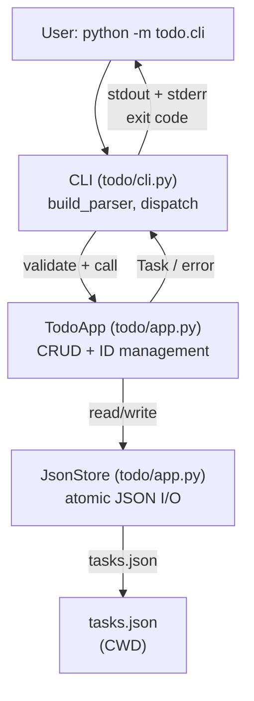

# Architecture

## Overview

The Todo CLI application is a two-layer, single-process command-line tool. The application layer (`todo/app.py`) provides all task-management logic and persistence; the CLI layer (`todo/cli.py`) translates command-line arguments into application calls and formats output. No network calls are made (NFR-005). All state is stored in a single `tasks.json` file in the current working directory (FR-020).

The design satisfies FR-001 through FR-024 and NFR-001 through NFR-006 by keeping the application layer free of I/O concerns and the CLI layer free of business logic.

## Components and responsibilities

| Component | File | Responsibilities |
|---|---|---|
| `Task` dataclass | `todo/app.py` | Immutable value object: `id: int`, `title: str`, `status: str` ("open"\|"done") |
| Error hierarchy | `todo/app.py` | `TodoError` → `StorageError` → `CorruptStorageError` for layered failure reporting (FR-022, FR-023) |
| `TodoApp` | `todo/app.py` | CRUD operations, ID assignment (FR-024), persistence via `JsonStore` (FR-020 through FR-023, NFR-003, NFR-004) |
| `JsonStore` | `todo/app.py` | Atomic read/write of `tasks.json`; raises `CorruptStorageError` or `StorageError` (NFR-001 through NFR-004) |
| CLI entry point | `todo/cli.py` | Parses `argv`, dispatches to `TodoApp`, formats stdout/stderr, returns exit codes 0/1/2 (FR-001, FR-014, FR-015) |
| Package init | `todo/__init__.py` | Package docstring only |
| Test suite | `tests/test_todo.py` | `unittest` tests; one test class per FR/NFR, each test cites its ID (NFR-006) |

## Data model and persistence

Storage file: `tasks.json` in the current working directory (FR-020).

Top-level shape:
```json
{
  "next_id": 4,
  "tasks": [
    {"id": 1, "title": "Buy milk", "status": "open"},
    {"id": 2, "title": "Call dentist", "status": "done"},
    {"id": 3, "title": "Pay bills", "status": "open"}
  ]
}
```

- `next_id` (int ≥ 1): next ID to assign; incremented on every `add`; never reset, ensuring monotonic non-reused IDs (FR-024).
- Each task record: `id` (int), `title` (str), `status` ("open" | "done").
- Missing or empty file → treated as `{"next_id": 1, "tasks": []}` (FR-021).
- Invalid JSON, wrong field types, or duplicate IDs → `CorruptStorageError`; file bytes unchanged (FR-022).
- Other I/O failures → `StorageError` (FR-023).
- Encoding: UTF-8, `ensure_ascii=False`, indent=2 (NFR-002).

## Control/data flow

```
User invocation: python -m todo.cli add "Buy milk"
       │
       ▼
CLI (todo/cli.py)
  parse_args(argv) ──► build_parser() produces subcommands add/list/done/reopen/delete
  validate input ──► empty/whitespace title rejected with exit 2 (FR-016, FR-014)
  call TodoApp method
       │
       ▼
TodoApp (todo/app.py)
  load() calls JsonStore.read() ──► reads tasks.json or returns empty state (FR-021)
  mutate in memory
  save() calls JsonStore.write() ──► atomic temp-file replace (NFR-003)
       │
       ▼
JsonStore (todo/app.py)
  write: open NamedTemporaryFile in same dir, json.dump, flush+fsync, os.replace (NFR-003)
  read:  json.loads, validate schema, raise CorruptStorageError on bad data (FR-022)
       │
       ▼
CLI formats output to stdout/stderr, returns exit code (FR-004 through FR-015)
```

No-ops (FR-008, FR-010) and failed operations (FR-012) do not write the file (NFR-004).

## Mermaid diagram



## Decisions

| Decision | Rationale | Requirements |
|---|---|---|
| Single `tasks.json` in CWD | Matches the specified storage contract exactly | FR-020 |
| `next_id` in JSON root | Ensures IDs never reuse even after deletion without scanning all IDs | FR-024 |
| Atomic write (temp + fsync + os.replace) | Prevents partial writes on crash; preserves existing file mode | NFR-003 |
| No write on no-op or failure | `list`, already-done, already-open, not-found leave file unchanged | NFR-004 |
| `CorruptStorageError` separate from `StorageError` | Distinguishes structural corruption (wrong schema) from I/O failures | FR-022, FR-023 |
| `main(argv, stdout, stderr, app) -> int` signature | Enables unit-testing without subprocess, no `sys.exit` required | NFR-006, FR-001 |
| Whitespace trim on add | Prevents invisible-difference duplicates; internal whitespace preserved | FR-017 |
| Empty/whitespace title rejected | Prevents meaningless tasks; exit 2 as usage error | FR-016, FR-014 |
| Duplicate titles allowed | Matches FR-018 explicitly | FR-018 |
| No title-length or task-count limit | Matches FR-019 explicitly | FR-019 |
| Standard library only | Matches NFR-001 | NFR-001 |

## Error handling

| Error | Trigger | Behaviour | Requirements |
|---|---|---|---|
| `CorruptStorageError` | tasks.json has invalid JSON, wrong field types, or duplicate task IDs | Propagates through CLI; stderr + exit 1 | FR-022 |
| `StorageError` | Other I/O failure (permission denied, disk full, etc.) | Propagates through CLI; stderr + exit 1 | FR-023 |
| Not found (ID missing) | `done`, `reopen`, `delete` with unknown ID | `Error: task {id} not found.` to stderr, exit 1 | FR-012 |
| Invalid ID (0, negative, non-numeric) | Any task-changing command | Treated as not found: exit 1 | FR-013 |
| Empty/whitespace title | `add` command | Usage error: USAGE message, exit 2 | FR-016, FR-014 |
| Unknown subcommand / wrong arg count | Argparse | USAGE message to stderr, exit 2 | FR-014 |

## Requirement coverage table

| Requirement | Component | Notes |
|---|---|---|
| FR-001 | CLI `build_parser` | Subcommands add/list/done/reopen/delete |
| FR-002 | `TodoApp.add`, CLI `cmd_add` | Returns Task, prints `Added: {id} [open] {title}` |
| FR-003 | `Task.status` default | Initialised to "open" |
| FR-004 | CLI `cmd_add` stdout | Exact format `Added: {id} [open] {title}` |
| FR-005 | `TodoApp.list_tasks`, CLI `cmd_list` | One line per task |
| FR-006 | CLI `cmd_list` | Prints `No tasks.` when list is empty |
| FR-007 | `TodoApp.done` | Sets status to "done" when currently "open" |
| FR-008 | `TodoApp.done` | Returns `(task, False)` when already done; CLI prints message |
| FR-009 | `TodoApp.reopen` | Sets status to "open" when currently "done" |
| FR-010 | `TodoApp.reopen` | Returns `(task, False)` when already open; CLI prints message |
| FR-011 | `TodoApp.delete` | Removes task from list |
| FR-012 | `TodoApp` all mutators | Raises `KeyError` → CLI prints `Error: task {id} not found.`, exit 1 |
| FR-013 | `TodoApp._validate_id` | ID ≤ 0 treated as not-found |
| FR-014 | CLI argparse + validation | USAGE prefix, exit 2 |
| FR-015 | CLI error handlers | stderr + non-zero exit |
| FR-016 | CLI `cmd_add` title validation | Empty/whitespace stripped then checked; exit 2 |
| FR-017 | CLI `cmd_add` | `title.strip()` before passing to app |
| FR-018 | `TodoApp.add` | No duplicate-title check |
| FR-019 | `TodoApp` | No limit enforced |
| FR-020 | `JsonStore` | File path = `store_path`, schema `{next_id, tasks}` |
| FR-021 | `JsonStore.read` | Missing/empty file returns default state |
| FR-022 | `JsonStore.read` | Schema validation raises `CorruptStorageError` |
| FR-023 | `JsonStore.read/write` | I/O exceptions wrapped in `StorageError` |
| FR-024 | `JsonStore` `next_id` field | Monotonic, persisted, never reused |
| NFR-001 | All code | Python 3.11+, stdlib only |
| NFR-002 | `JsonStore.write` | UTF-8, ensure_ascii=False, indent=2 |
| NFR-003 | `JsonStore.write` | NamedTemporaryFile + fsync + os.replace |
| NFR-004 | `TodoApp` no-op paths | File not written on list, no-op, or failure |
| NFR-005 | Entire codebase | No network calls anywhere |
| NFR-006 | `tests/test_todo.py` | unittest, temp dirs, FR/NFR citations |
